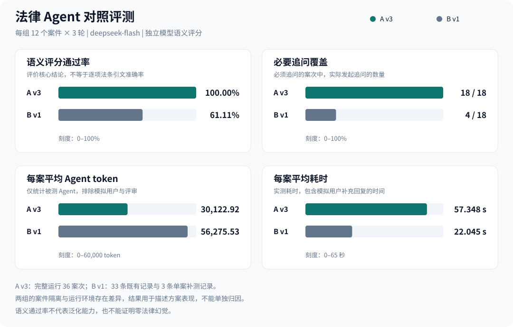
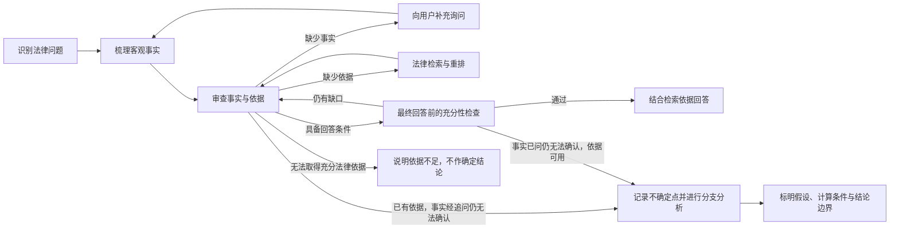

# 中国法律智能体

**本项目针对普通对话 AI 回答法律问题时的分析不严谨、未经核实就给出假设性回答，以及编造或误用法律依据的法律幻觉问题。**

通过“核实事实 → 检索法律 → 审查依据 → 形成结论”的固定工作流，减少把猜测当事实、把条件分支当结论的回答，让法律分析过程与引用依据可以检查。

| 常见问题 | 本项目的处理方式 |
| --- | --- |
| 🧩 分析不严谨 | 按案件整理客观事实，检查时间、地域与法律适用条件，回答前再次审查事实和依据 |
| ❓ 假设性回答 | 关键事实缺失时先追问，不直接用“如果……那么……”替代核实；确实无法补充时，明确区分已知结论与有依据的假设分支 |
| ⚖️ 法律幻觉 | 检索并选择可核验的法律依据，约束引用范围；依据不足时说明缺口，不把未知法条或适用条件当成确定事实 |

面向中国法律法规检索与案件分析，内置 **703,271 条法律知识记录**。

英文项目名：**Chinese Legal Agent** · 仓库名：`chinese-legal-agent`。

## 📊 A v3 与 B v1 对照测试

**A v3** 为当前源码中的固定 LangGraph 法律工作流，包含案件隔离、历史追问与不确定性回答节点。**B v1** 为提示词驱动的 LangChain Agent，同样可以调用法律检索和 `ask_user`，由模型自主选择执行步骤。

两组均使用 **deepseek-flash**、同一法律检索实现和基于预设事实的 LLM 模拟用户，覆盖 **12 个案件 × 3 轮，共 36 个案次/组**。评审模型为独立的 **GLM-5.3-flash**。



| 指标 | 🧭 A v3：固定工作流 | 💬 B v1：自主工具循环 |
| --- | ---: | ---: |
| 🎯 语义评分通过 | **36/36（100.00%）** | 22/36（61.11%） |
| 🔎 必须追问的案次中实际发起追问 | **18/18** | 4/18 |
| 🗣️ 实际追问总次数 | 22 | 4 |
| 🧮 每案平均 Agent token | **30,122.92** | 56,275.53 |
| ⏱️ 每案平均耗时 | 57.348 秒 | **22.045 秒** |
| 🛠️ 每案平均工具调用 | 1.917 | 1.583 |

**评分口径：** 必须追问的关键事实未实际获取时，即使附条件结论正确，也判错。关键事实取得后再判断核心法律结论。模拟用户与评审 token 不计入 Agent 指标，模拟用户耗时计入；工作流节点切换不算工具调用。A v3 有 16 个案次通过不确定性回答节点完成，拒答为 0。

**执行范围：** A v3 为完整三轮运行；B v1 汇总 33 条既有记录与 3 条单案补测，后续案件未随该单案重新执行，首轮补测还包含独立检索进程的模型加载成本。因此耗时不能视为两组完整连续执行的严格速度对照。

**结果边界：** 这是法律子图与自主工具 Agent 的整体方案对照，两组的案件隔离、模型适配器和运行环境也存在差异。12 个案件已经用于调试，不能据此推断泛化能力，也不能把 100% 语义通过率理解为零法律幻觉或全部法条引文准确。

查看完整问题、实际追问、最终回答及评分理由：[A v3 报告](comparison/reports/A_v3.md) · [B v1 报告](comparison/reports/B_v1.md)。

**必须配置智谱 API Key（`ZAI_API_KEY`）：本项目的向量化依赖智谱 GLM Embedding-3，无论对话使用 GLM 还是 DeepSeek，都需要该 Key。**

## 快速运行

当前默认部署环境为 **Windows + Docker Desktop（Linux containers）+ NVIDIA GPU**。安装并启动 Docker Desktop（含 Docker Compose），确保容器能够使用 NVIDIA GPU。

### 1. 下载发布版并启动

发布版直接使用 Docker Hub 的三个 `sysoe/chinese-legal-agent*:0.5.2` 镜像，无需安装 Git、Python、Node.js 或在本机构建。

在 PowerShell 中执行：

```powershell
New-Item -ItemType Directory -Path chinese-legal-agent -Force | Out-Null
Set-Location chinese-legal-agent
Invoke-WebRequest -Uri https://raw.githubusercontent.com/sysoebuilder/chinese-legal-agent/v0.5.2/compose.release.yaml -OutFile compose.release.yaml
docker compose -f compose.release.yaml pull
docker compose -f compose.release.yaml up -d --wait
```

详见 [发布版部署说明](docs/dockerhub-release.md)。

需要从源码构建时，先安装 Git，再执行：

在 PowerShell 中执行：

```powershell
git clone https://github.com/sysoebuilder/chinese-legal-agent.git
cd chinese-legal-agent
.\scripts\start-compose.ps1
```

源码启动脚本构建并启动前端、API、Worker、PostgreSQL、Redis、Qdrant 和初始化服务，无需安装宿主机 Python。API 与 Worker 使用镜像内的源码，不挂载主机 `src`。

首次启动时，初始化容器自动创建配置、从 GitHub Release 下载并恢复法律库及 BM25 索引、从 Hugging Face 下载 BGE 重排模型。已有完整资源会跳过；初始化不需要模型 API Key，API 和 Worker 在初始化成功后启动。发布版需要访问 Docker Hub、GitHub Release 与 Hugging Face；源码构建还需要访问 PyPI 与 PyTorch 下载源。

查看初始化进度时，另开终端，在项目目录执行：

```powershell
docker compose -f compose.release.yaml logs -f initialize
```

### 2. 打开网页并配置模型

访问 **[http://127.0.0.1:3000](http://127.0.0.1:3000)**，打开左下角设置：

1. 在“模型”中选择 GLM 或 DeepSeek，填写 API Key 并保存。
2. **必须配置智谱 API Key（`ZAI_API_KEY`）**。法律语义检索和长期记忆的向量化依赖智谱 GLM Embedding-3，联网搜索也使用智谱服务；使用 DeepSeek 对话模型时同样必须配置该 Key。
3. 在插件设置中确认法律流程已启用；在“权限”中可选择“限制”，让中、高、严重风险的工具调用经过人工确认。

模型、密钥和权限均通过网页设置修改。当前默认权限模式为“无限制”。如果启用了 `AGENT_API_TOKEN`，在网页连接设置中填写相同的访问令牌。

### 3. 开始法律对话

提供具体事实、时间、地域和你的问题，例如：

> 我在上海工作，公司在劳动合同到期前通知解除合同。我工作了三年，最近一年平均月工资为 12,000 元。解除理由是岗位调整。我可能有哪些权利，还需要补充哪些事实？

Agent 会识别法律问题、梳理客观事实、检索可能适用的法律依据，并在事实不足时向你提问。补充信息提交成功后，中断面板收起，流程继续；工具审批通过“同意 / 拒绝”按钮完成。

网页支持流式思考与回答、历史会话、停止生成和失败重试。停止完成后，可在原会话继续发送消息。

| 入口 | 地址 |
| --- | --- |
| 网页 | [http://127.0.0.1:3000](http://127.0.0.1:3000) |
| API 文档 | [http://127.0.0.1:8001/docs](http://127.0.0.1:8001/docs) |

## 法律库与检索

当前默认法律发布包包含 **703,271 条法律知识记录**，保存在 Qdrant 的 `npc_laws` 集合中。这里的数量是知识库记录数，不代表独立法律文件的部数；初始化会核对集合数量和 BM25 索引完整性。

检索根据争议点组织，支持两条路径：

- **明确法规名称时**：使用 BM25 检索标题，再结合正文关键词筛选候选依据。
- **尚不明确法规名称时**：使用 GLM Embedding-3 生成案情向量，在 Qdrant 中进行语义检索。

候选结果使用本地 **BGE-reranker-v2-m3** 根据客观案情重排。多个争议点可以在一轮中并行检索；决策节点按证据缺口选择新的检索角度，避免反复搜索近义表述。

默认资源来自固定版本的发布包，初始化不会自动追踪法规变更。法律适用时间和地域也是回答流程需要检查的内容。

有标题检索测评集现包含 **300 条用例、240 个不同目标法条**。在人工提供标题和正文关键词的条件下，BM25 前 50 条候选召回率为 **100%**，经 BGE 重排后 Recall@1 为 **94%**、Recall@5 为 **99.67%**。这不代表端到端法律回答准确率；详见 [测评数据与复现说明](evals/README.md) 和 [完整报告](eval-results/legal-retrieval-titled-300-bm25-rerank.md)。

## 严谨的法律分析流程

中国法律智能体将法律问题交给独立的 LangGraph 法律工作流，围绕事实和已检索依据组织结论。



| 环节 | 已实现的约束 |
| --- | --- |
| 案件识别 | 区分新案件、已有案件的追问与非法律问题，按案件保存事实和分析状态 |
| 事实梳理 | 从用户陈述和补充信息中提取客观事实，提示模型不得猜测未提供的事实或预设结论 |
| 依据选择 | 由决策节点选择可用的检索结果，缺少依据时继续检索 |
| 补充询问 | 通过可持久化中断请求关键事实，保存历史问题并约束重复提问，收到回应后从 checkpoint 继续 |
| 回答前检查 | 再次审查事实和依据是否足够，可退回补充询问、检索、不确定性回答或拒绝回答 |
| 回答生成 | 限定模型引用提供的法律依据，说明适用时间、地域和结论的不确定性 |
| 不确定性回答 | 已追问但事实仍无法确认、且已有可用依据时，传入结构化上下文与不确定点，分别说明有依据的假设分支，不编造事实 |
| 失败处理 | 对可恢复错误进行有限重试；无法取得充分依据时明确说明原因 |

这些约束由结构化状态、工作流路由和模型提示共同实现，方便检查案件分析过程与恢复中断任务。

## 产品能力

| 能力 | 实现 |
| --- | --- |
| 法律案件分析 | 多案件状态、事实整理、争议点检索、依据审查、补充询问与回答前检查 |
| 网页对话 | React + TypeScript，流式思考与回答、历史分页、深浅主题、模型切换 |
| 模型接入 | GLM / DeepSeek，可在网页设置模型与服务地址 |
| 权限控制 | “限制 / 无限制”两档；限制模式下对中、高、严重风险工具展示参数并请求同意或拒绝 |
| 中断与恢复 | PostgreSQL checkpoint、人工输入与工具审批、失败重试、停止后继续会话 |
| 长期记忆 | 异步整理对话记忆，GLM Embedding-3 向量化，Qdrant 检索、去重和更新 |
| 工具扩展 | 时间、联网搜索、邮件、记忆管理，以及本地与云端 MCP 连接 |
| API | FastAPI 运行接口、SSE 事件、Redis + Celery 任务调度 |
| 可观测性 | 结构化日志、节点耗时、运行状态、持久化会话与任务恢复信息 |

## 部署与数据持久化

发布版 `compose.release.yaml` 的项目名为 `chinese-legal-agent`，数据卷名称以 `chinese-legal-agent_` 开头。源码构建使用独立的 `compose.yaml`。

发布版 API 和 Worker 共用 `sysoe/chinese-legal-agent:0.5.2` 镜像，前端使用 `sysoe/chinese-legal-agent-web:0.5.2`，初始化使用 `sysoe/chinese-legal-agent-init:0.5.2`。PostgreSQL、Redis 和 Qdrant 是独立服务。源码构建使用对应的 `:local` 镜像；修改代码后需要重新构建对应镜像并重新创建容器。

当前部署的业务服务全部在容器中运行。Agent 不接入 Windows 终端 MCP，Compose 和启动脚本也不启动宿主机终端服务。详见 [部署说明](docs/run-api.md)。

| 数据 | 持久化位置 |
| --- | --- |
| 模型、插件、密钥、权限配置 | 主机 `data/models.json`、`mouldes.json`、`secrets.json`、`permissions.json`，挂载到 `/app/config` |
| 会话、运行状态、日志、checkpoint | Docker 卷 `chinese-legal-agent_postgres` |
| 法律向量与长期记忆 | Docker 卷 `chinese-legal-agent_qdrant` |
| BM25 索引与法律初始化缓存 | Docker 卷 `chinese-legal-agent_app-data`，容器路径 `/app/data` |
| 队列持久化 | Docker 卷 `chinese-legal-agent_redis-data` |
| 重排模型 | 主机 `models/bge-reranker-v2-m3`，Worker 只读挂载到 `/app/models` |
| 可选法律离线资源 | Docker 卷 `chinese-legal-agent_law-assets` |

常用运维命令：

```powershell
# 查看服务与日志
docker compose -f compose.release.yaml ps -a
docker compose -f compose.release.yaml logs -f api worker

# 更新镜像并启动
docker compose -f compose.release.yaml pull
docker compose -f compose.release.yaml up -d --wait

# 停止服务，保留持久化数据
docker compose -f compose.release.yaml down
```

`docker compose down -v` 会删除命名卷中的数据库、索引和队列数据。备份命令为 `.\.venv\Scripts\python.exe scripts/backup-data.py`，备份保存在 `data/backups/<时间>/`；恢复步骤见 [部署与备份说明](docs/run-api.md#备份与恢复)。

邮件工具需要在密钥设置中填写 `QQ_SMTP_USERNAME` 和 `QQ_SMTP_AUTH_CODE`。启用哪些工具、连接哪些 MCP、采用哪档权限，均可在网页中配置。

## API 与法律 MCP

网页以 Run API 为基础，通过 SSE 接收实时事件。外部程序也可以创建运行、查询状态、响应中断和读取会话历史，详见 [Run API 使用说明](docs/run-api.md)。

法律检索还提供独立的 MCP Server，暴露 `search_laws` 工具。在共享服务和初始化资源已就绪后，可通过 stdio 接入：

```powershell
docker compose -f compose.release.yaml run --rm -T --no-deps worker python -m chinese_legal_agent.mcp_server
```

需要 HTTP 接入时：

```powershell
docker compose -f compose.release.yaml run --rm --no-deps -p 127.0.0.1:8000:8000 worker python -m chinese_legal_agent.mcp_server --http --host 0.0.0.0 --port 8000
```

MCP 地址为 `http://127.0.0.1:8000/mcp`，当前独立法律 MCP 的 HTTP 入口不提供鉴权。法律 MCP 与网页共用 Qdrant 法律集合、BM25 索引和本地重排模型。

## 代码与文档

| 路径 | 内容 |
| --- | --- |
| `src/chinese_legal_agent/langchain_agent/legal/` | 法律工作流、案件状态、结构化决策与回答检查 |
| `src/chinese_legal_agent/mcp_server/` | 法律检索与独立 MCP Server |
| `src/chinese_legal_agent/law_index.py` | 法律 BM25 索引 |
| `src/chinese_legal_agent/reranker.py` | 法律与记忆检索重排 |
| `src/chinese_legal_agent/api/` | Run API、SSE、任务调度与 checkpoint 恢复 |
| `src/chinese_legal_agent/config/` | 配置加载、旧配置迁移和原子更新 |
| `src/chinese_legal_agent/initialize*.py` | 配置、法律快照、BM25 与重排模型初始化 |
| `src/chinese_legal_agent/memory/` | 记忆提取、向量化、检索与持久化 |
| `frontend/` | 网页界面 |
| `tests/` | 工作流、接口、配置与恢复链路测试 |

- [部署、接口与备份恢复](docs/run-api.md)
- [模型、插件、密钥与权限配置](docs/model-configuration.md)
- [前端开发说明](frontend/README.md)

版本 **0.5.2** · Python **3.11+** · LangChain / LangGraph · FastAPI / Celery · PostgreSQL / Redis / Qdrant

## 搜索关键词

中国法律智能体、法律 AI 助手、中国法律法规、法律知识库、法律法规检索、法律依据检索、案件分析、法律 RAG、检索增强生成、混合检索、向量检索、BM25、重排模型、人工审批、MCP、LangGraph。

Chinese Legal Agent, Chinese law, legal AI assistant, legal knowledge base, legal research, case analysis, legal RAG, retrieval-augmented generation, hybrid search, vector search, BM25, reranking, human-in-the-loop, MCP, LangGraph.

## English

**Chinese Legal Agent addresses insufficient fact checking, unverified hypothetical conclusions, and fabricated or misapplied legal grounds in conversational legal answers.** It provides Chinese law retrieval and case analysis, backed by 703,271 indexed legal knowledge records rather than distinct statutes.

The legal workflow maintains case facts and clarification history, retrieves and reranks candidate legal grounds, requests missing information, and reviews whether the evidence is sufficient before generating an answer. When facts remain unavailable after clarification, a dedicated node explains supported conditional branches and their limits. Generation is instructed to use supplied legal grounds; missing legal grounds cannot be replaced by factual assumptions.

In the recorded 12-case, three-repeat evaluation, [A v3](comparison/reports/A_v3.md) passed semantic grading in 36/36 runs and [B v1](comparison/reports/B_v1.md) in 22/36. Both agents use deepseek-flash and the same retrieval tools. B v1 combines existing records with a partial rerun; runtime, case isolation and adapter differences limit direct causal and timing comparisons. These small development-set results do not establish generalization or a zero-hallucination rate.

For the default Windows deployment, install Docker Desktop with Linux containers and Docker Compose, and an NVIDIA GPU with container support. Download `compose.release.yaml` and follow the [Docker Hub deployment guide](docs/dockerhub-release.md), then open [http://127.0.0.1:3000](http://127.0.0.1:3000) and configure the model in Settings. Source builds can use Git and `scripts/start-compose.ps1`. A GLM API key is required for semantic law retrieval and memory embeddings, including when DeepSeek is the chat model.

Initialization restores missing law data and BM25 indexes from a fixed release and downloads the BGE reranker. Complete resources are reused. API and Worker run the source packaged in their image; the web UI serves built static assets. Windows terminal MCP is excluded from the Agent and Compose deployment. Configuration and model files use host mounts; database and index data persist in named Docker volumes.

See the [deployment and API guide](docs/run-api.md), [configuration guide](docs/model-configuration.md), and [frontend guide](frontend/README.md).
