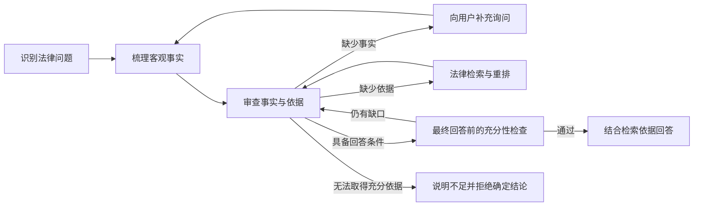

# agent100 · 律法 Agent

**面向中国法律法规检索与案件分析的严谨律法 Agent，内置 70 万余条法律知识记录。**

## 快速运行

当前默认部署环境为 **Windows + Docker Desktop（Linux containers）+ NVIDIA GPU**。安装 Python 3.11+、Git 和支持 provider 的 Docker Compose 2.36+，启动 Docker Desktop，并确保容器能够使用 NVIDIA GPU。

### 1. 获取项目并启动

在 PowerShell 中执行：

```powershell
git clone https://github.com/sysoebuilder/agent100.git
cd agent100
.\scripts\start-compose.ps1
```

启动脚本自动准备宿主机 Python 环境与 Windows 终端 MCP provider，再构建并启动前端、API、Worker、PostgreSQL、Redis、Qdrant 和初始化服务。API 与 Worker 使用镜像内的源码，不挂载主机 `src`。

首次启动时，初始化容器自动创建配置、从 GitHub Release 下载并恢复法律库及 BM25 索引、从 Hugging Face 下载 BGE 重排模型。已有完整资源会跳过；初始化不需要模型 API Key，API 和 Worker 在初始化成功后启动。首次构建和资源下载需要访问 PyPI、PyTorch 下载源、GitHub Release 与 Hugging Face。

查看初始化进度时，另开终端，在项目目录执行：

```powershell
docker compose logs -f initialize
```

### 2. 打开网页并配置模型

访问 **[http://127.0.0.1:3000](http://127.0.0.1:3000)**，打开左下角设置：

1. 在“模型”中选择 GLM 或 DeepSeek，填写 API Key 并保存。
2. 法律语义检索和长期记忆使用 GLM Embedding-3，联网搜索也使用 GLM 服务，因此还需配置 GLM Key（`ZAI_API_KEY`），包括使用 DeepSeek 对话模型时。
3. 在插件设置中确认法律流程已启用；在“权限”中可选择“限制”，让中、高、严重风险的工具调用经过人工确认。

模型、密钥和权限均通过网页设置修改。当前默认权限模式为“无限制”。如果启用了 `AGENT_API_TOKEN`，在网页连接设置中填写相同的访问令牌。

### 3. 开始法律对话

提供具体事实、时间、地域和你的问题，例如：

> 我在上海工作，公司在劳动合同到期前通知解除合同。我工作了三年，最近一年平均月工资为 12,000 元。解除理由是岗位调整。我可能有哪些权利，还需要补充哪些事实？

Agent 会识别法律问题、梳理客观事实、检索可能适用的法律依据，并在事实不足时向你提问。补充信息提交成功后，中断面板收起，流程继续；工具审批通过“同意 / 拒绝”按钮完成。

网页支持流式思考与回答、历史会话、停止生成和失败重试。停止完成后，可在原会话继续发送消息。

| 入口 | 地址 |
| --- | --- |
| 网页 | [http://127.0.0.1:3000](http://127.0.0.1:3000) |
| API 文档 | [http://127.0.0.1:8001/docs](http://127.0.0.1:8001/docs) |

## 法律库与检索

当前默认法律发布包包含 **703,271 条法律知识记录**，保存在 Qdrant 的 `npc_laws` 集合中。这里的数量是知识库记录数，不代表独立法律文件的部数；初始化会核对集合数量和 BM25 索引完整性。

检索根据争议点组织，支持两条路径：

- **明确法规名称时**：使用 BM25 检索标题，再结合正文关键词筛选候选依据。
- **尚不明确法规名称时**：使用 GLM Embedding-3 生成案情向量，在 Qdrant 中进行语义检索。

候选结果使用本地 **BGE-reranker-v2-m3** 根据客观案情重排。多个争议点可以在一轮中并行检索；决策节点按证据缺口选择新的检索角度，避免反复搜索近义表述。

默认资源来自固定版本的发布包，初始化不会自动追踪法规变更。法律适用时间和地域也是回答流程需要检查的内容。

## 严谨的法律分析流程

agent100 将法律问题交给独立的 LangGraph 法律工作流，围绕事实和已检索依据组织结论。



| 环节 | 已实现的约束 |
| --- | --- |
| 案件识别 | 区分新案件、已有案件的追问与非法律问题，按案件保存事实和分析状态 |
| 事实梳理 | 从用户陈述和补充信息中提取客观事实，提示模型不得猜测未提供的事实或预设结论 |
| 依据选择 | 由决策节点选择可用的检索结果，缺少依据时继续检索 |
| 补充询问 | 通过可持久化中断请求关键事实，收到回应后从 checkpoint 继续 |
| 回答前检查 | 再次审查事实和依据是否足够，可退回补充询问、检索或拒绝回答 |
| 回答生成 | 限定模型引用提供的法律依据，说明适用时间、地域和结论的不确定性 |
| 失败处理 | 对可恢复错误进行有限重试；无法取得充分依据时明确说明原因 |

这些约束由结构化状态、工作流路由和模型提示共同实现，方便检查案件分析过程与恢复中断任务。

## 产品能力

| 能力 | 实现 |
| --- | --- |
| 法律案件分析 | 多案件状态、事实整理、争议点检索、依据审查、补充询问与回答前检查 |
| 网页对话 | React + TypeScript，流式思考与回答、历史分页、深浅主题、模型切换 |
| 模型接入 | GLM / DeepSeek，可在网页设置模型与服务地址 |
| 权限控制 | “限制 / 无限制”两档；限制模式下对中、高、严重风险工具展示参数并请求同意或拒绝 |
| 中断与恢复 | PostgreSQL checkpoint、人工输入与工具审批、失败重试、停止后继续会话 |
| 长期记忆 | 异步整理对话记忆，GLM Embedding-3 向量化，Qdrant 检索、去重和更新 |
| 工具扩展 | 时间、联网搜索、邮件、记忆管理，以及本地与云端 MCP 连接 |
| Windows 终端 | 宿主机 MCP 执行 PowerShell，Compose provider 管理服务启停 |
| API | FastAPI 运行接口、SSE 事件、Redis + Celery 任务调度 |
| 可观测性 | 结构化日志、节点耗时、运行状态、持久化会话与任务恢复信息 |

## 部署与数据持久化

后端 API 和 Worker 共用 `agent100:local` 镜像，前端使用 `agent100-web:local`，初始化使用 `agent100-init:local`。PostgreSQL、Redis 和 Qdrant 是独立服务。镜像由当前源码构建；修改代码后需要重新构建对应镜像并重新创建容器。

Windows 终端 MCP 在宿主机运行，由启动脚本准备的 `.venv` 提供运行环境。它是当前默认部署中的宿主机组件，服务地址和认证信息由 provider 配置，运行日志保存在 `data/compose-mcp/`。Linux 主机部署需移除 Windows provider 及 Worker 对它的依赖，并按需要配置远端终端 MCP，详见 [部署说明](docs/run-api.md)。

| 数据 | 持久化位置 |
| --- | --- |
| 模型、插件、密钥、权限配置 | 主机 `data/models.json`、`mouldes.json`、`secrets.json`、`permissions.json`，挂载到 `/app/config` |
| 会话、运行状态、日志、checkpoint | Docker 卷 `agent100_postgres` |
| 法律向量与长期记忆 | Docker 卷 `agent100_qdrant` |
| BM25 索引与法律初始化缓存 | Docker 卷 `agent100_app-data`，容器路径 `/app/data` |
| 队列持久化 | Docker 卷 `agent100_redis-data` |
| 重排模型 | 主机 `models/bge-reranker-v2-m3`，Worker 只读挂载到 `/app/models` |
| 可选法律离线资源 | Docker 卷 `agent100_law-assets` |

常用运维命令：

```powershell
# 查看服务与日志
docker compose ps -a
docker compose logs -f api worker

# 更新镜像并启动；已准备好的宿主机环境可以直接使用 Compose
docker compose up -d --build --wait

# 停止服务，保留持久化数据
docker compose down
```

`docker compose down -v` 会删除命名卷中的数据库、索引和队列数据。备份命令为 `.\.venv\Scripts\python.exe scripts/backup-data.py`，备份保存在 `data/backups/<时间>/`；恢复步骤见 [部署与备份说明](docs/run-api.md#备份与恢复)。

邮件工具需要在密钥设置中填写 `QQ_SMTP_USERNAME` 和 `QQ_SMTP_AUTH_CODE`。启用哪些工具、连接哪些 MCP、采用哪档权限，均可在网页中配置。

## API 与法律 MCP

网页以 Run API 为基础，通过 SSE 接收实时事件。外部程序也可以创建运行、查询状态、响应中断和读取会话历史，详见 [Run API 使用说明](docs/run-api.md)。

法律检索还提供独立的 MCP Server，暴露 `search_laws` 工具。在共享服务和初始化资源已就绪后，可通过 stdio 接入：

```powershell
docker compose run --rm -T --no-deps worker python -m ai_agent_learning.mcp_server
```

需要 HTTP 接入时：

```powershell
docker compose run --rm --no-deps -p 127.0.0.1:8000:8000 worker python -m ai_agent_learning.mcp_server --http --host 0.0.0.0 --port 8000
```

MCP 地址为 `http://127.0.0.1:8000/mcp`，当前独立法律 MCP 的 HTTP 入口不提供鉴权。法律 MCP 与网页共用 Qdrant 法律集合、BM25 索引和本地重排模型。

## 代码与文档

| 路径 | 内容 |
| --- | --- |
| `src/ai_agent_learning/langchain_agent/legal/` | 法律工作流、案件状态、结构化决策与回答检查 |
| `src/ai_agent_learning/mcp_server/` | 法律检索与独立 MCP Server |
| `src/ai_agent_learning/law_index.py` | 法律 BM25 索引 |
| `src/ai_agent_learning/reranker.py` | 法律与记忆检索重排 |
| `src/ai_agent_learning/api/` | Run API、SSE、任务调度与 checkpoint 恢复 |
| `src/ai_agent_learning/config/` | 配置加载、旧配置迁移和原子更新 |
| `src/ai_agent_learning/initialize*.py` | 配置、法律快照、BM25 与重排模型初始化 |
| `src/ai_agent_learning/memory/` | 记忆提取、向量化、检索与持久化 |
| `frontend/` | 网页界面 |
| `tests/` | 工作流、接口、配置与恢复链路测试 |

- [部署、接口与备份恢复](docs/run-api.md)
- [模型、插件、密钥与权限配置](docs/model-configuration.md)
- [前端开发说明](frontend/README.md)

版本 **0.5.0** · Python **3.11+** · LangChain / LangGraph · FastAPI / Celery · PostgreSQL / Redis / Qdrant

## English

**agent100 is a legal agent for Chinese law retrieval and case analysis, backed by 703,271 legal knowledge records.** The count refers to indexed records, rather than distinct statutes.

The legal workflow maintains case facts, retrieves and reranks candidate legal grounds, requests missing information, and reviews whether the evidence is sufficient before generating an answer. Generation is instructed to use the supplied legal grounds and explain uncertainty, time, and jurisdiction. The workflow can return to retrieval or decline a definitive conclusion when the available grounds are insufficient.

For the default Windows deployment, install Python 3.11+, Docker Desktop with Linux containers, Docker Compose 2.36+, and an NVIDIA GPU with container support. Clone the repository and run `scripts/start-compose.ps1`, then open [http://127.0.0.1:3000](http://127.0.0.1:3000) and configure the model in Settings. A GLM API key is required for semantic law retrieval and memory embeddings, including when DeepSeek is the chat model.

Initialization restores missing law data and BM25 indexes from a fixed release and downloads the BGE reranker. Complete resources are reused. API and Worker run the source packaged in their image; the web UI serves built static assets. Windows terminal MCP runs on the host. Configuration and model files use host mounts; database and index data persist in named Docker volumes.

See the [deployment and API guide](docs/run-api.md), [configuration guide](docs/model-configuration.md), and [frontend guide](frontend/README.md).
